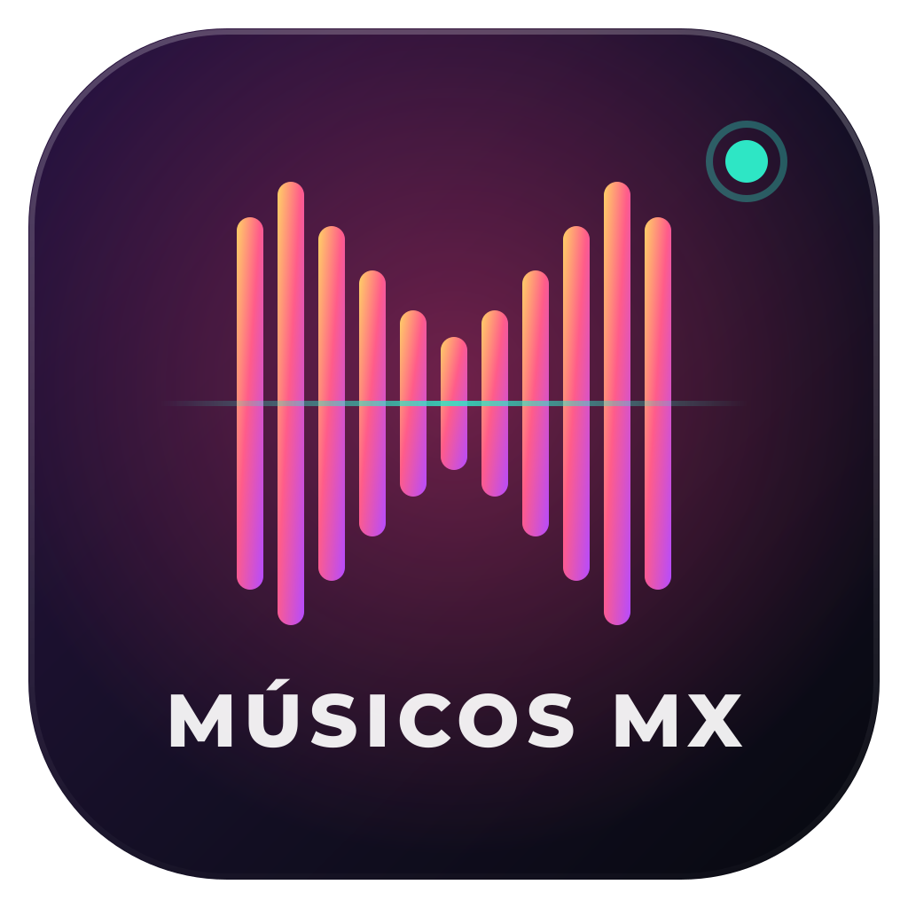
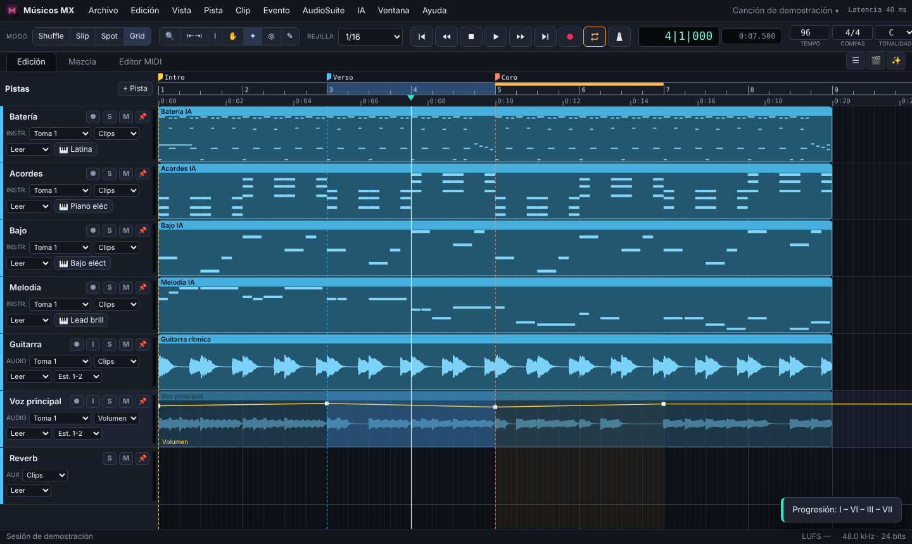

<p align="center"></p>

<h1 align="center">Músicos MX</h1>
<p align="center"><b>Estación de trabajo de audio digital (DAW) libre, multiplataforma y con inteligencia artificial local</b><br>
Windows · macOS · Linux (.deb · .rpm · AppImage) · Android — Licencia GPL-3.0-o-posterior</p>



## ¿Qué es?

Músicos MX es un programa para **grabar, editar, mezclar, masterizar y exportar** música, podcasts y audio para video. Toma como referencia el flujo de trabajo de las estaciones profesionales de estudio (ventanas de Edición y Mezcla, modos Shuffle/Slip/Spot/Grid, herramienta inteligente, listas de reproducción para tomas, AudioSuite, buses, automatización, bounce de stems) y añade **herramientas de IA que se ejecutan en tu propio equipo**.

## Funciones

| Área | Incluye |
|---|---|
| **Grabación** | Multipista, preconteo, metrónomo, punch in/out, grabación en bucle con tomas, monitorización, compensación de latencia, teclados MIDI USB |
| **Edición** | Shuffle/Slip/Spot/Grid, herramientas Zoom/Recorte/Selector/Mano/Inteligente/Scrub/Lápiz, dividir, fundidos, ganancia de clip, copiar/pegar, duplicar, nudge, consolidar, varispeed, quitar silencios, marcadores, deshacer ilimitado (200 pasos) |
| **MIDI** | Rollo de piano, velocidad, cuantizar, humanizar, transponer, ajustar a escala, teclado virtual, importar/exportar .mid |
| **Instrumentos** | Sintetizador con 13 sonidos y baterías Acústica, 808 y Latina |
| **Mezcla** | 6 inserciones y 4 envíos por canal, buses auxiliares, paneo estéreo y **3D binaural**, medidores, LUFS, automatización Leer/Touch/Latch/Escribir |
| **Complementos** | EQ 7 bandas, compresor, limitador, compuerta, de-esser, reverb, delay, coro/flanger, saturación, filtro, trémolo, imagen estéreo, doblador |
| **AudioSuite** | Normalizar (pico/LUFS), ganancia, reversa, polaridad, DC, estirar tiempo, cambiar tono, render de inserciones |
| **IA local** | Separación de stems · Transcripción voz→texto (Whisper) · Audio→MIDI · Afinación automática · Limpieza de ruido · Tempo y tonalidad · Cuantizar audio por ataques · Mezcla automática · Masterización asistida con referencia · Mejores tomas (auto-comping) · Compositor (batería, acordes, bajo, melodía) · **Asistente en español** con LLM local opcional (Ollama) |
| **Exportación** | WAV 16/24/32f, MP3, stems, fábrica de bounces (mezcla, instrumental, a cappella, stems), MIDI, subtítulos SRT |
| **Video** | Pista y ventana de video sincronizadas para post-producción |

## Descargas

Ve a **[Releases](../../releases)** y elige tu sistema:

| Sistema | Archivo |
|---|---|
| Windows | `Musicos-MX-Setup-x.y.z.exe` (instalador) o `Musicos-MX-x.y.z-portable.exe` |
| macOS | `Musicos-MX-x.y.z-mac-arm64.dmg` (Apple Silicon) · `…-mac-x64.dmg` (Intel) |
| Debian/Ubuntu/Mint | `musicos-mx_x.y.z_amd64.deb` |
| Fedora/openSUSE/RHEL | `musicos-mx-x.y.z.x86_64.rpm` |
| Cualquier Linux | `Musicos-MX-x.y.z.AppImage` |
| Android 7+ | `Musicos-MX-x.y.z.apk` |

El **manual del usuario** completo está en [`docs/MANUAL.md`](docs/MANUAL.md), en PDF ([`docs/Manual-Musicos-MX.pdf`](docs/Manual-Musicos-MX.pdf)) y dentro de la aplicación (Ayuda › Manual).

## Compilar desde el código

```bash
npm install
npm start            # ejecutar en modo desarrollo (Electron)
npm run serve        # probar en el navegador en http://localhost:8080
npm run dist:linux   # AppImage, .deb y .rpm
npm run dist:win     # instalador NSIS y portable
npm run dist:mac     # .dmg y .zip (en macOS)
npm run android      # APK (SDK de Android o paquetes aapt/apksigner/zipalign/dalvik-exchange)
```

Al publicar un *Release* en GitHub, el flujo `.github/workflows/release.yml` compila los instaladores de Windows, macOS, Linux y Android y los adjunta automáticamente.

### Estructura

```
src/js/engine   motor de audio (grafo de mezcla, transporte, grabación, render), complementos, instrumentos
src/js/ai       DSP (FFT, STFT, WSOLA, YIN, LUFS), funciones de IA y asistente
src/js/ui       ventanas de Edición, Mezcla, Editor MIDI y diálogos
electron/       aplicación de escritorio
android/        aplicación Android (WebView nativo)
docs/           manual del usuario
```

## Privacidad

El audio nunca sale de tu equipo. La única descarga opcional es el modelo libre Whisper la primera vez que usas la transcripción (desde huggingface.co).

## Licencia

Copyright © 2026 **Santiago Miguel** — 744 354 8848 — chago2850@gmail.com

Este programa es software libre: puede redistribuirlo y/o modificarlo bajo los términos de la **Licencia Pública General GNU** publicada por la Free Software Foundation, ya sea la versión 3 de la Licencia o (a su elección) cualquier versión posterior. Se distribuye **SIN GARANTÍA ALGUNA**. Consulte [`LICENSE`](LICENSE).

Músicos MX es un proyecto independiente, no afiliado ni respaldado por Avid Technology. “Pro Tools” es marca registrada de su titular y se menciona solo como referencia.
